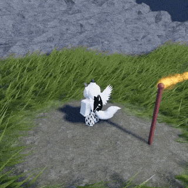
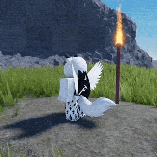

# Tux Physics Tails

<table>
  <tr>
    <td><strong>Global Wind</strong></td>
    <td><strong>Character Movement</strong></td>
  </tr>
  <tr>
    <td></td>
    <td></td>
  </tr>
</table>

**Procedural tail motion for Roblox** · v4.2 · by **[@R3dTuxedo](https://www.roblox.com/users/120018794/profile)**

Tux Physics Tails is a customizable, client-side physics-style animation engine for rigid tails. It supports modern `AccessoryRigidConstraint` accessories, legacy `AccessoryWeld` accessories, and custom parts. Animation is computed independently for each viewing player; no remotes or server physics simulation are required.

## Downloads

| Edition | File | For |
| --- | --- | --- |
| **Roblox Studio** | [`TuxPhysicsTails-v4.2.rbxm`](https://github.com/R3dTuxedo/tux-physics-tails-v4/releases/latest/download/TuxPhysicsTails-v4.2.rbxm) | Import directly into Roblox Studio |
| **Rojo / source** | `View Source Code` | Browse, clone, or download the source from GitHub |

Only the complete Studio model and Rojo source are distributed; there are no separate partial client/engine downloads.

## Studio installation (.rbxm)

1. Import **TuxPhysicsTails.rbxm** using *Insert from File*.
2. The model contains clearly named `ReplicatedStorage` and `StarterPlayerScripts` folders, with the corresponding scripts inside.
3. **For permanent installation in Studio (recommended)**, unpack manually in Edit mode: move the ModuleScript from the package's `ReplicatedStorage` folder into the real `ReplicatedStorage`, and move `TuxPhysicsTailsClient` from the package's `StarterPlayerScripts` folder to `StarterPlayer > StarterPlayerScripts`. Delete the now-empty installation model.
4. **For runtime installation**, when the model is placed in `Workspace` on a running server, its **AutoInstall** Script moves both items to the correct services and removes the empty installation model.

**Important:** Auto-installation during Studio Play mode is temporary; those changes do **not** persist in the saved place after stopping Play. To publish a persistent installation, unpack in Studio **Edit** mode before publishing. The installer never replaces any existing scripts; on name conflicts, it warns and leaves the package untouched.

Expected hierarchy after installation:

```text
ReplicatedStorage
└─ TuxPhysicsTails                   ModuleScript
   ├─ Configuration                 ModuleScript
   ├─ Spring                        ModuleScript
   ├─ Wind                          ModuleScript
   ├─ Wag                           ModuleScript
   └─ Types                         ModuleScript

StarterPlayer
└─ StarterPlayerScripts
   └─ TuxPhysicsTailsClient         LocalScript
```

The LocalScript starts the engine automatically. No other scripts or packages are required.

## Rojo installation

This package's `default.project.json` describes **only** `ReplicatedStorage.TuxPhysicsTails` and `StarterPlayer.StarterPlayerScripts.TuxPhysicsTailsClient`. The services and intermediary folders explicitly use `$ignoreUnknownInstances: true`, meaning Rojo will not delete unrelated children of those services/folders during synchronization. **The engine's own ModuleScript and its children are still managed by Rojo.**

When integrating into an existing team's project, it is often easier to **copy the two mapped paths** from `default.project.json` into your existing project rather than replacing your current project file. Do not sync a second, competing project to the same place at the same time.

## Core behavior

- **Attachment-based pivots:** Uses source attachment frames for modern accessories; supports either endpoint order. Tail mesh `PivotOffset` and imported part origins are not assumed to be at the hinge.
- **Elastic movement:** Analytical damped springs with configurable frequency and damping ratio.
- **Gravity relative to rest:** `NeutralGravity = 196.2` by default. At normal Roblox gravity, the tail's authored rest pose stays at rest; gravity above/below that value adds downward/upward pressure. `GravityScale` controls intensity.
- **Legacy wind pressure:** The original Tux wind-fluctuation formula is back in the editable `Wind` module. Global wind can be combined with `CustomWind`.
- **Independent idle animation:** Wag animation now lives in the editable `Wag` module and fades out during character movement.
- **Client preferences:** Disable physics for a player, character, accessory, or controller; change defaults or individual tail options at runtime.
- **Automatic setup:** Watches players, respawns and late-arriving accessory joints. NPC containers can be registered explicitly.
- **Cleanup and performance:** Joint restoration, event cleanup, camera-distance culling and simulation budget.

## Quick examples

### Change the feel of all tails

```luau
--!strict
local Tails = require(game:GetService("ReplicatedStorage").TuxPhysicsTails)

Tails.SetDefaults({
    Frequency = 3.0,
    DampingRatio = 0.75,
    NeutralGravity = 196.2,
    GravityScale = 0.12,
    WindEnabled = true,
    WindInfluence = 1.0,
})
```

### Make a custom tail from a part

```luau
--!strict
local Tails = require(game:GetService("ReplicatedStorage").TuxPhysicsTails)

-- Set tailPart.CFrame to its intended resting position beforehand.
local controller = Tails.Attach(tailPart, torso, {
    Pivot = CFrame.new(0, -0.3, torso.Size.Z * 0.5),
    TipAttachment = tailPart.TailTip, -- optional Attachment on the tail
    Frequency = 2.7,
    DampingRatio = 0.65,
    WagEnabled = true,
})

controller:SetOptions({ CustomWind = Vector3.new(12, 0, 0) })
controller:SetEnabled(false) -- keeps the tail in its rest pose
controller:SetEnabled(true)
controller:Destroy() -- removes the weld created by Attach()
```

### Control what you see

```luau
Tails.SetPlayerEnabled(otherPlayer, false)
Tails.SetCharacterEnabled(npcCharacter, false)
Tails.SetAccessoryEnabled(accessory, false)

Tails.AddIncludedName("cube.003accessory")
Tails.ScanCharacter(character)
Tails.Configure({ MaxDistance = 260, MaxVisibleTails = 150 })
```

These settings only apply to the **local client**. The simulation does not replicate tail poses or apply server-authoritative collision forces.

## Editing the animation

| File | Purpose |
| --- | --- |
| `Configuration.luau` | Default global and per-tail settings |
| `Spring.luau` | Analytical damped oscillator |
| `Wind.luau` | Sine-driven wind-pressure fluctuation |
| `Wag.luau` | Idle wag waveform and idle/movement blend |
| `Types.luau` | Exported strict Luau types for all public settings and controllers |
| `init.luau` | Controller engine, accessory watchers and public API |

For the **full callable API**, including every function signature, parameters, return values, configuration option and defaults, read **[API.md](docs/API.md)**.

## Compatibility and limits

Tux Physics Tails is intended for **rigid tail handles/assemblies**, not skeletal/bone-deformed tails. Modern `RigidConstraint` endpoints must be ordinary `Attachment`s parented directly under `BasePart`s; animated `Bone` endpoints are not supported. The adapter temporarily disables an individual source constraint locally and animates a private Weld, then restores that constraint on cleanup. It does not modify character rig attachments.

The engine cannot infer the anatomical base of arbitrary, badly-authored geometry without references. For unusual shapes, provide an explicit `Pivot` (root-local `CFrame` or `Attachment`) and `TipAttachment` (tail-local `Vector3` or `Attachment`). For custom parts, use an unanchored, non-collidable, massless tail if appropriate. Do not have competing scripts modifying the same joint.

Tux Physics Tails has not been verified in every avatar-rig/network-ownership combination. Please verify your intended characters and accessory catalog in Roblox Studio before shipping your own experience.

## Creator and credit

**Created by [@R3dTuxedo](https://www.roblox.com/users/120018794/profile).** Credit the creator in your game description or an in-game credits location. See the original [Tux Physics Tails community thread](https://devforum.roblox.com/t/tux-physics-tails-v3/3648854).

## License

Tux Physics Tails is free to use in personal and commercial Roblox experiences, subject to the [Tux Physics Tails Attribution License](LICENSE).

**Creator credit is required.** If you use Tux Physics Tails in a publicly accessible experience, you must credit **[@R3dTuxedo](https://www.roblox.com/users/120018794/profile)** in your experience description or an accessible in-game credits section.

Example attribution:

> Tail physics by @R3dTuxedo

You may modify and redistribute the engine, provided you retain the original copyright notice and license.